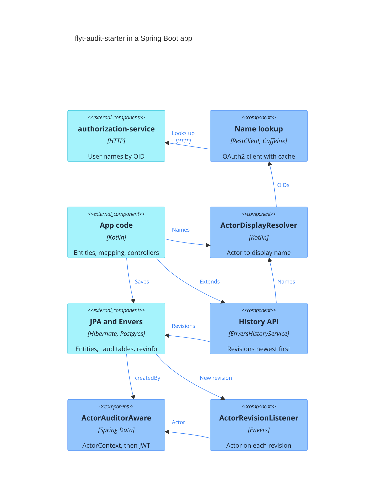

# Architecture

C4 level 3 for flyt-audit-starter. The starter has no system context or containers of its own: it runs inside each
Spring Boot app that depends on it. The diagram shows that app with the starter's components. Blue is the starter,
turquoise is the app, Hibernate and authorization-service.

## C4 level 3: Components

- **Recording the actor.** Entities extend `CreatedAuditedEntity` or `AuditedEntity`. Spring Data JPA auditing asks
  `ActorAuditorAware` for `createdBy` and `lastModifiedBy` when an entity is persisted or updated. It uses the actor bound
  by `ActorContext.withActor` (for Kafka listeners, from the `flyt.actor` header), then the JWT in the security context,
  and otherwise `Actor.System`. For `@Audited` entities, Envers creates a revision when the transaction commits, and
  `ActorRevisionListener` stores the same actor in `revinfo`. Hibernate creates the listener through Spring's bean
  container, so it gets `flytAuditorAware` injected. `AuditMetricsListener` counts writes in the same way.
- **Reading history.** `EnversHistoryService` reads revisions with the Envers `AuditReader`, newest first, and
  `HistoryControllerSupport` exposes them as `GET /{id}/history` and `GET /history`. The app extends both, chooses the
  snapshot shape, and secures the endpoints.
- **Display names.** `Actor` stores only the OID of a user. `ActorDisplayResolver` resolves names at presentation time,
  in one batch per page, through `ActorNameLookup`. The default lookup calls authorization-service with an OAuth2
  `client_credentials` `RestClient` and a Caffeine cache. authorization-service registers its own local lookup instead.
  Without an OAuth2 client, the starter falls back to a lookup that resolves no names.
- **Auto-configuration.** `FlytAuditAutoConfiguration`, `FlytAuditJpaAuditingAutoConfiguration` and
  `AuthorizationRestClientConfiguration` set all of this up. Every bean the app may replace is `@ConditionalOnMissingBean`.

Not in the starter: Flyway migrations for the app's tables (only a template for `revinfo`), authorization of the history
endpoints, and storing personal data such as names.
